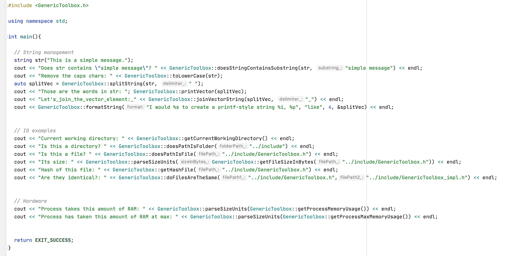

[](https://creativecommons.org/licenses/by-nd/4.0)
[](https://github.com/nadrino/cpp-generic-toolbox/releases/)


## Description

C++ Generic Toolbox is a **header-only** namespace which aims at being included in any cpp project. This toolbox gathers a collection of useful functions which I got tired of copy pasting over my different projects...

## Features

- `std::string` management tools
- Filesystem/IO tools
- Hardware tools (like RAM info)
- Conversion tools
- Displaying tools (like a simple progress bar)


## Showcase



## Requirements

- **The CMake targets require C++14 in header-only mode, or C++17 in compiled mode.**

## Getting Setup

You can add cpp-generic-toolbox to your existing project as a submodule for example. In this guide we assume that your project is using CMake. In your CMakeLists.txt, add the following lines:

```cmake
include_directories(path/to/cpp-generic-toolbox/include)
```

Now you can include the header in your source file:

```c++
#include "GenericToolbox.String.h"
```

## Header-only and compiled modules

Direct inclusion of the existing headers remains header-only by default. Use the
specific header for each module, for example `GenericToolbox.Fs.h`;
`GenericToolbox.h` remains available as a deprecated compatibility header.
The CMake targets use C++14 in header-only mode and require at least C++17 for
compiled modules. External libraries can require a newer standard, as ROOT does.

Each module has its own target. CMake propagates the module's dependencies, include
paths, C++ standard and compiled-mode definitions to consumers:

```cmake
add_subdirectory(path/to/cpp-generic-toolbox)
target_link_libraries(MyApplication PRIVATE GenericToolbox::Fs)
```

No implementation library is built by default. To compile the modules instead:

```cmake
set(GENERIC_TOOLBOX_COMPILED ON)
add_subdirectory(path/to/cpp-generic-toolbox)
target_link_libraries(MyApplication PRIVATE GenericToolbox::Fs)
```

`GenericToolbox::Fs` automatically links `GenericToolbox::String`, which in turn
links `GenericToolbox::Macro`. Compiled modules produce separate libraries such as
`GenericToolboxFs` and `GenericToolboxString`; there is no monolithic binary.
Set `GENERIC_TOOLBOX_BUILD_SHARED=ON` to build shared libraries. Its default follows
`BUILD_SHARED_LIBS`; otherwise the libraries are static and position independent.

Available compiled modules are `Macro`, `Log`, `String`, `Os`, `Fs`, `Vector`,
`Utils`, `Time`, `Thread` and `Stream`. The `Map`, `Loops`, `ZipIterator`, `Misc`,
`Wrappers` and `MakeEnum` targets are interface targets for templates and macros.
The existing SDK-specific `Switch`, `Borealis` and `Midas` headers retain their
header-only integration with those SDKs.

`GenericToolbox::GenericToolbox` is an interface target aggregating the core and
all enabled extensions. Applications can link it instead of selecting individual
modules. It creates no additional library.

### Optional extensions

ROOT, nlohmann JSON and yaml-cpp are disabled by default. Enable only the extensions
used by your project:

```cmake
set(GENERIC_TOOLBOX_COMPILED ON)
set(GENERIC_TOOLBOX_WITH_ROOT ON)
set(GENERIC_TOOLBOX_WITH_JSON ON)
set(GENERIC_TOOLBOX_WITH_YAML ON)
add_subdirectory(path/to/cpp-generic-toolbox)
target_link_libraries(MyApplication PRIVATE
  GenericToolbox::Root
  GenericToolbox::Json
  GenericToolbox::Yaml
)
```

Each enabled extension has its own target and, in compiled mode, its own library.
The core does not depend on these libraries. Disabled extensions do not trigger a
package search. JSON and YAML can use dependency targets already supplied by the
parent project; otherwise CMake finds the corresponding installed package.
Direct header-only use of an extension still works with manually supplied include
paths and external libraries, without enabling its CMake option.

### Selecting modes per module

`GENERIC_TOOLBOX_COMPILE_<MODULE>` accepts `AUTO`, `ON` or `OFF` (uppercase module
name, such as `GENERIC_TOOLBOX_COMPILE_FS`). `AUTO` follows
`GENERIC_TOOLBOX_COMPILED`, including when that option changes on reconfiguration.
For example, compile only filesystem utilities while retaining other modules in
header-only mode:

```bash
cmake -S . -B build -DGENERIC_TOOLBOX_COMPILE_FS=ON
```

The templates and small inline methods remain in the public headers. Other
implementations live in `include/implementation/GenericToolbox.<Module>.impl.h`:
the public header includes them in header-only mode, while the corresponding
`src/GenericToolbox.<Module>.cpp` compiles them in compiled mode. Keep the selected
mode consistent for each module across an application and its libraries; the
CMake targets propagate the required `CPP_GENERIC_TOOLBOX_<MODULE>_COMPILED`
definitions automatically.

Header-only mode retains the original per-translation-unit state. In compiled
mode, mutable namespace state belongs to its module library: progress-bar state,
clock history, OS statistics, color codes and ROOT verbosity can be shared across
source files. Compile-time settings such as `PROGRESS_BAR_FILL_TAG`,
`CPP_GENERIC_TOOLBOX_BATCH` and `CPP_GENERIC_TOOLBOX_NOCOLOR` must be consistent
between a compiled module and its consumers. Set them on the relevant module's
CMake target with `PUBLIC` visibility, or in the parent before `add_subdirectory`.

### Building and testing this repository

Examples, tests and CMake package installation are enabled for standalone builds
and disabled by default when included with `add_subdirectory`. The parent project
can control them with `GENERIC_TOOLBOX_BUILD_EXAMPLES`,
`GENERIC_TOOLBOX_BUILD_TESTS` and `GENERIC_TOOLBOX_INSTALL_PACKAGE`.
Compiled libraries are installed even when package installation is disabled.

```bash
cmake -S . -B build -DGENERIC_TOOLBOX_COMPILED=ON
cmake --build build
ctest --test-dir build --output-on-failure
cmake --install build --prefix /path/to/install
```

The tests exercise the selected modes and enabled extensions, direct C++14
header-only inclusion, cross-file state, threading and standalone public headers.
They belong to this repository and are not enabled by GUNDAM.

With package installation enabled, another project can use the installed targets:

```cmake
find_package(GenericToolbox REQUIRED CONFIG COMPONENTS Fs)
target_link_libraries(MyApplication PRIVATE GenericToolbox::Fs)
```

Request only the installed components you use: `COMPONENTS Fs` does not search
for ROOT, JSON or YAML even if their extension libraries were installed. Omitting
components selects the full installed toolbox.
